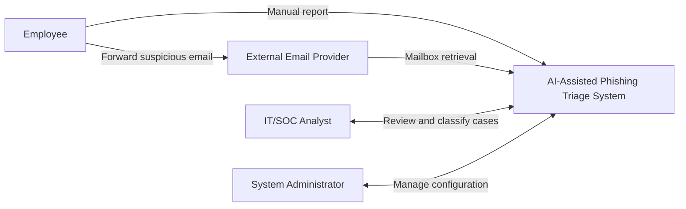
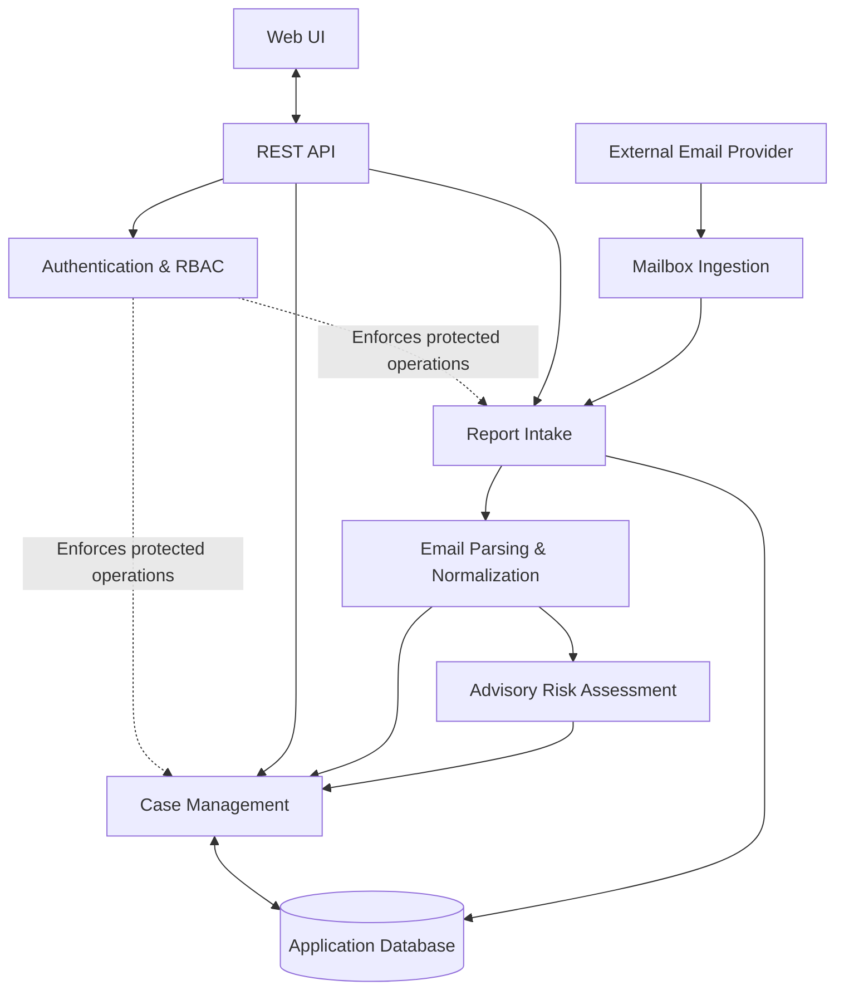

# System Vision & Boundary

AI-Assisted Phishing Triage System

Version 1.1  |  SENG 321  |  Software Architect deliverable

## 1. System Vision

### 1.1 Purpose

The AI-Assisted Phishing Triage System is a web-based decision-support application for collecting, assessing, prioritizing, and managing employee-reported suspicious emails. Employees report messages either through a web form or by forwarding them to a designated mailbox. Both channels produce a common report and case-management workflow.

### 1.2 Problem and Value

Unstructured phishing reports make it difficult for IT/SOC teams to track cases, prioritize urgent investigations, and maintain consistent outcomes. The proposed system centralizes reports and presents preliminary risk indicators to analysts. It aims to improve visibility and triage consistency; efficiency gains remain hypotheses to be evaluated.

### 1.3 Objectives

- Support manual web submission and designated-mailbox forwarding.
- Normalize reports into one case format and preserve accepted submissions.
- Provide an advisory risk score, Low/Medium/Critical category, and supporting indicators.
- Enable analysts to investigate, record notes, and issue final classifications.
- Enforce role-based access and retain an auditable case history.
## 2. Stakeholders & Actors

| Actor | Primary interaction | Authorization boundary |
| --- | --- | --- |
| Employee | Submit suspicious emails; view status of reports securely attributed to their account | Cannot view unverified forwarded reports, others’ reports, or finalize cases |
| IT/SOC Analyst | Review all cases; examine indicators; record decisions | Can classify cases; cannot manage roles by default |
| System Administrator | Manage accounts, roles, mailbox settings, and operational logs | No analyst privileges unless separately assigned |
| Organization Management | Receives organizational value from better reporting | Not a direct MVP application actor |

The external email provider receives forwarded messages and exposes mailbox access; it is a supporting external system, not an application user. Sender addresses in forwarded messages are not sufficient proof of employee identity. Forwarded reports appear in an employee’s history only after reliable account attribution; unattributed reports remain accessible to authorized analysts.

## 3. System Scope

### 3.1 Included in the MVP

- Manual reporting: authenticated employee enters message information or uploads a supported .eml file.
- Forwarding reporting: a configured mailbox is polled or accessed through a supported provider interface; received messages enter the same report workflow.
- Safe extraction of sender metadata, subject, text and URLs without executing content or opening links.
- Preliminary risk assessment with a separate analysis status, score, category, and explainable indicators; failed analysis remains reviewable.
- Analyst dashboard with case list, filters, detail views, notes, and investigation statuses: New, Under Review, Resolved.
- Final analyst classification: Phishing, Legitimate, or Inconclusive, stored separately from automated risk. A case can be marked Resolved only when a final classification has been recorded; Resolved + Inconclusive is permitted.
- Authentication, backend-enforced RBAC, report history, and basic event traceability.
### 3.2 Workflow and Status Rules

- **Risk category** is an advisory severity label: `Low`, `Medium`, or `Critical` (a deliberate three-level MVP scale; `Critical` is the highest). It is not the analyst’s final verdict.
- **Analysis status** belongs to `RiskAssessment` and is distinct from case investigation status. Suggested values: `Pending`, `Completed`, `Failed`. Failure does not close or delete a case.
- **Investigation status** belongs to `Case`: `New`, `Under Review`, `Resolved`. Analysis completion does not automatically change investigation status.
- **Final classification** belongs to `Case`: `Phishing`, `Legitimate`, or `Inconclusive`; it is required to transition to `Resolved`.
- **Report–Case cardinality:** For the MVP, each accepted `Report` creates exactly one `Case`, and each `Case` belongs to exactly one `Report` (1:1). Reports of the same suspicious email from different employees remain separate cases. Ingestion idempotency only prevents processing the same provider mailbox message twice; cross-employee case merging is out of scope.
- **Forwarded report visibility:** `Report.submitter_attribution_status` distinguishes verified account attribution from unverified attribution. Only verified reports are shown in that employee’s report history; unverified reports are available to authorized analysts.

### 3.3 Excluded from the MVP

Automatic deletion or quarantine, enterprise SIEM/SOAR integration, dynamic malware analysis, attachment execution, automatic browsing of suspicious links, monitoring all organizational mailboxes, training an LLM from scratch, and autonomous incident response are excluded.

### 3.4 Acceptance Boundary

The MVP must demonstrate both submission channels, consistent case creation, a preliminary assessment or explicit failure state, analyst review and classification, persistent history, and role-based access enforcement using controlled test data.

## 4. System Boundary

Inside the application boundary: web UI, REST backend, authentication/authorization, mailbox ingestion adapter, email parser/normalizer, risk-assessment orchestration, case-management logic, and application database. These are logical modules and may be deployed as a single modular monolith.

Outside the boundary: the email provider and mail delivery infrastructure, hosting platform operations, and any optional third-party model-inference provider. The project owns the integration interfaces but not those providers’ availability or internal behavior.

### 4.1 Trust Boundaries

- Employee submissions and email content are untrusted inputs; validate size, format, and content.
- The browser never accesses the database directly; the backend checks every protected operation.
- Mailbox credentials and application secrets remain server-side.
- Forwarded messages are not automatically linked to an authenticated employee unless identity verification is adequate. Unverified forwarded reports are excluded from employee-facing history and remain available to analysts.
- Risk recommendations cannot trigger enforcement actions; analysts retain final authority.
## 5. High-Level Architecture & Context

The design uses a modular monolithic backend with a REST API and logically isolated processing modules. Manual and forwarded submissions converge on a normalized report pipeline. Risk assessment and case classification remain separate concerns.

### 5.1 Context Diagram

The system box represents the application boundary. The email provider and human actors are outside it.

### 5.2 Logical Component Diagram

These are logical modules, not separate microservices. The external email provider connects to the mailbox ingestion adapter; only backend components access the database.

## 5.3 Core Data Concepts

| Entity | Responsibility |
| --- | --- |
| User | Identity and role |
| Report | Source channel, received content, timestamps, submitter attribution status (`Verified` / `Unverified`); one-to-one link to Case |
| RiskAssessment | Score, risk category (`Low` / `Medium` / `Critical`), evidence, analysis status (`Pending` / `Completed` / `Failed`) |
| Case | Investigation status (`New` / `Under Review` / `Resolved`), analyst ownership, final classification; one-to-one link to Report |
| CaseHistory | Timestamped actions and analyst notes |

## 6. Assumptions, Constraints & Quality Requirements

### 6.1 Assumptions

A dedicated test mailbox and supported access method will be available. Development uses synthetic, public, or appropriately anonymized samples. The first deployment targets a controlled academic demonstration, not enterprise production.

### 6.2 Constraints

The project is built by a six-person team within a semester. The assessment method may be rule-based, ML-based, or hybrid; no external inference provider is required. The solution must avoid executing attachments and navigating to potentially malicious URLs.

### 6.3 Non-Functional Requirements

| ID | Requirement / verification intent |
| --- | --- |
| NFR-01 Security | Backend authorization and input validation; test unauthorized operations |
| NFR-02 Privacy | Role-limited report access; controlled sample data |
| NFR-03 Reliability | Persist accepted reports; retain manual-review path on assessment failure |
| NFR-04 Usability | Clear employee submission and analyst review workflows |
| NFR-05 Maintainability | Distinct modules and documented API contracts |
| NFR-06 Interoperability | REST interfaces and common representation for both intake channels |
| NFR-07 Performance | **Provisional acceptance targets:** under a controlled test workload of 10 concurrent users and 1,000 stored reports, at least 95% of manual report-creation API requests complete within 3 seconds and at least 95% of dashboard list API requests within 2 seconds (excluding network latency and asynchronous risk assessment). Measure with repeatable load tests; revise targets only through documented team agreement. |
| NFR-08 Traceability | Timestamp case transitions and final analyst decisions |
| NFR-09 Fault Handling | Gracefully handle malformed input and mailbox/model errors |
| NFR-10 Testability | Unit, integration, and end-to-end coverage of both intake channels |

## 7. Risks, Dependencies & Final Boundary

| Risk | Mitigation |
| --- | --- |
| Mailbox integration failure | Dedicated test mailbox; isolate provider adapter and log failures |
| Misleading risk assessment | Explain indicators; evaluate on labeled data; human final decision |
| Malicious or malformed inputs | Validation, limits, non-execution, and controlled rendering |
| Unauthorized disclosure | Backend RBAC and restricted operational access |
| Unrepresentative datasets | Document source, licensing, bias, and evaluation limitations |
| Semester delivery risk | Prioritize complete end-to-end workflow over optional integrations |
| Duplicate forwarded messages | Idempotent ingestion by provider message identity where available |

Final boundary: the application accepts reported messages, extracts supported indicators, produces advisory assessments, and enables human-controlled case management. It does not administer organizational mail infrastructure or autonomously block, quarantine, or delete messages.
