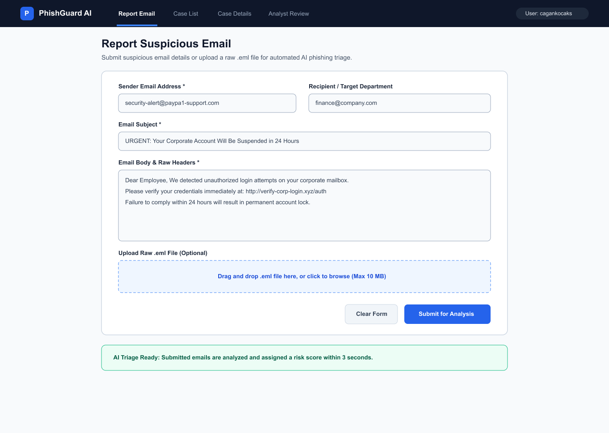
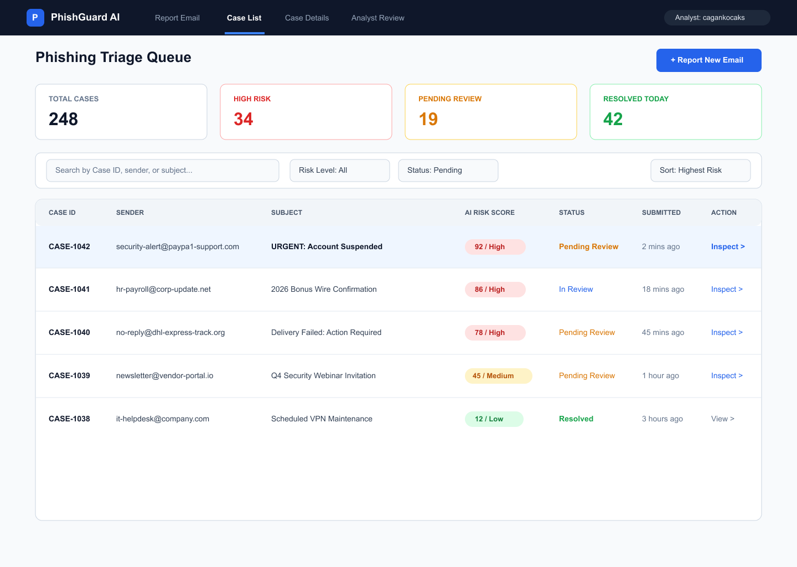
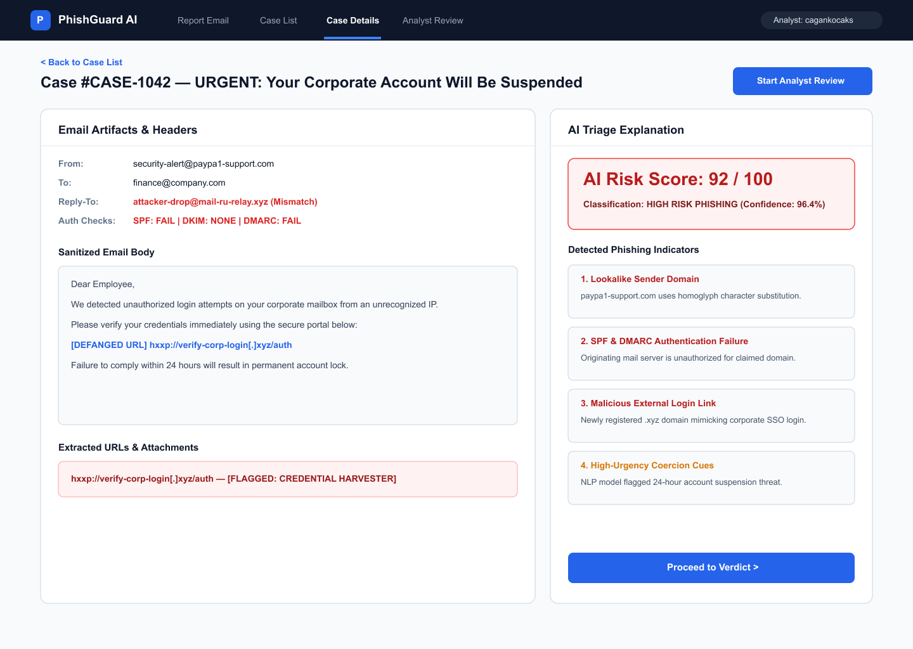
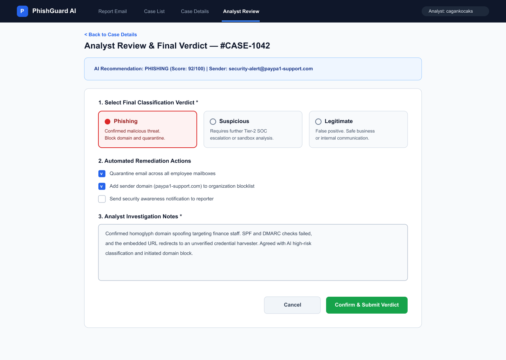

# UI/UX Design & Interactive Prototype — AI-Powered Phishing Triage System

## 1. Figma Design & Prototype Links
- **Figma Design & Interactive Prototype:** [Open Figma Design & Prototype](https://www.figma.com/design/Ho3mPLo7hWMjRVVoUSROkx/AI-Powered-Phishing-Triage-%E2%80%94-UI-UX-Design?node-id=0-1&t=D4YXHLCLD7z4YmB8-1)

---

## 2. Design Principles & Visual Hierarchy
- **Rapid Triage Prioritization:** High-risk cases are highlighted using high-contrast severity badges (`High` = Red, `Medium` = Amber, `Low` = Green) paired with numeric AI risk scores (`0–100`).
- **Role-Based Separation:** End users interact with a streamlined email submission screen, while security analysts operate inside a structured queue-to-detail-to-verdict workflow.
- **Safety-First Rendering:** Suspicious links are defanged (`hxxp://...[.]xyz`) and email bodies are displayed in plain-text containers to prevent accidental click-throughs during review.

---

## 3. Screen Specifications

### 3.1. Report Suspicious Email Screen
Allows end users to report suspicious emails manually or by uploading a raw `.eml` file.
- **Key Elements:** Sender address, target department, subject line, body/headers textarea, `.eml` drag-and-drop uploader, and **Submit for Analysis** CTA.

### 3.2. Case List (Triage Queue) Screen
Provides security analysts with an overview of incoming cases prioritized by AI risk score.
- **Key Elements:** KPI summary cards (*Total Cases*, *High Risk*, *Pending Review*, *Resolved Today*), search bar, risk/status filters, and a sortable triage queue table.

### 3.3. Case Details & AI Analysis Screen
Displays email metadata and sanitized content alongside explainable AI risk indicators.
- **Key Elements:** Header authentication checks (`SPF`, `DKIM`, `DMARC`), defanged URLs, AI Risk Score banner (`92/100`), itemized phishing indicators, and **Start Analyst Review** CTA.

### 3.4. Analyst Review & Verdict Screen
Enables human-in-the-loop classification and remediation execution.
- **Key Elements:** Verdict selector (`Phishing`, `Suspicious`, `Legitimate`), automated remediation checkboxes (quarantine, domain blocklist), analyst investigation notes, and **Confirm & Submit Verdict** button.

---

## 4. Interactive Prototype Flow
1. **Report Email** $\rightarrow$ Clicking **Submit for Analysis** navigates to the **Case List**.
2. **Case List** $\rightarrow$ Clicking **CASE-1042** opens **Case Details**.
3. **Case Details** $\rightarrow$ Clicking **Start Analyst Review** opens **Analyst Review**.
4. **Analyst Review** $\rightarrow$ Clicking **Confirm & Submit Verdict** returns to the updated **Case List**.

---

## 5. Technical Feasibility & API Alignment
All screens align directly with the OpenAPI specification (`docs/OPENAPI.yaml`) and planned frontend/backend stack:

| Screen | UI Data & Actions | Backend / API Alignment |
| :--- | :--- | :--- |
| **Report Email** | Sender, subject, body, `.eml` upload | Case submission endpoint (`POST`) |
| **Case List** | Paginated queue, risk & status filtering | Case listing endpoint with query filters (`GET`) |
| **Case Details** | Headers, sanitized body, AI score & indicators | Case detail retrieval by ID (`GET`) |
| **Analyst Review** | Final verdict enum, remediation flags, analyst notes | Analyst review/verdict submission (`POST`/`PATCH`) |

- **Implementation Feasibility:** Built with standard 1440px grid components (cards, tables, form inputs, status badges) that map cleanly to React/TypeScript components without custom rendering overhead.