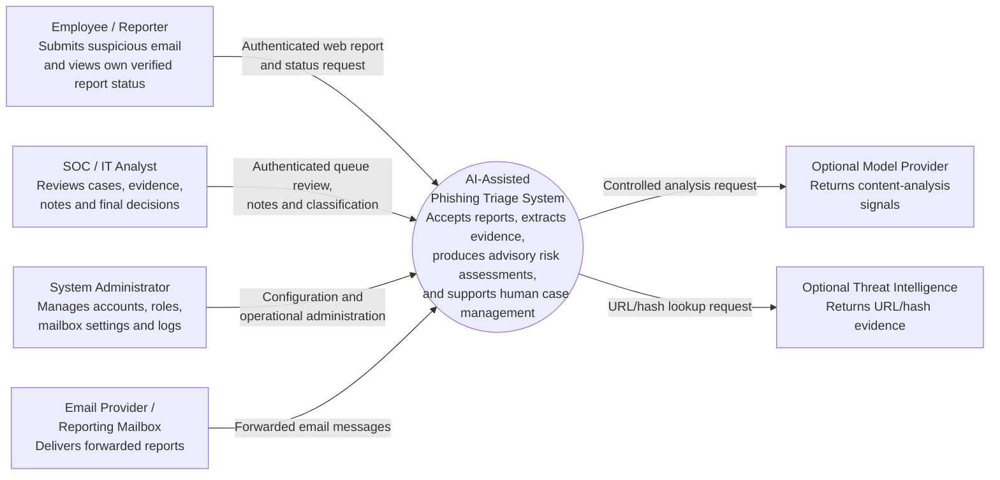
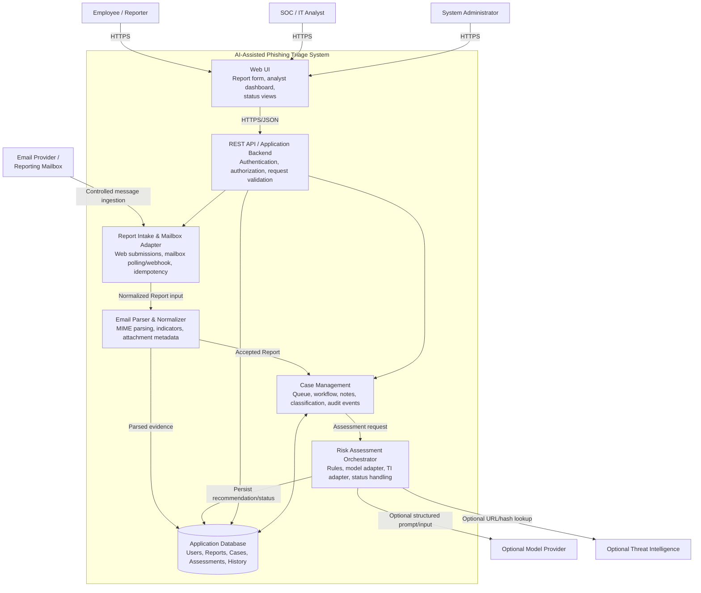
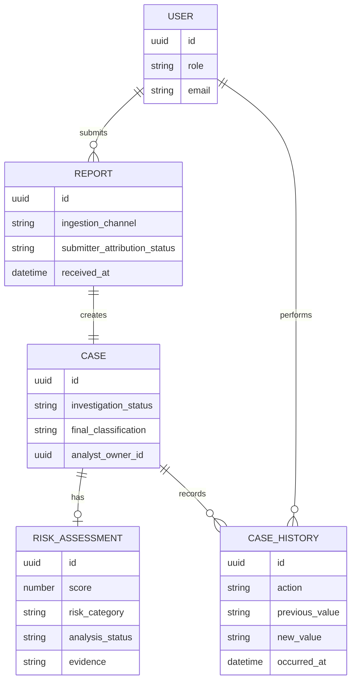
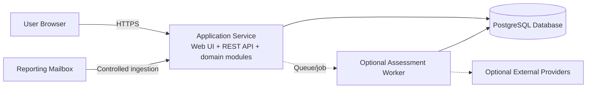

# C4 Architecture Documentation

## 1. Document Information

| Field | Value |
| --- | --- |
| Project | AI-Assisted Phishing Triage System |
| Course | SENG 321 – Software Engineering Project |
| Document | C4 Architecture Documentation |
| Version | 1.0 draft |
| Status | Sprint 2 working document |
| Related issue | GitHub Issue #23 |

This document describes the proposed architecture using the C4 model. It defines the system context, application containers, trust boundaries, major data flows, and the rationale for the selected technology direction.

The diagrams use Mermaid syntax so that the source remains editable in the repository. They can be rendered by GitHub-compatible Markdown viewers or exported using a Mermaid-compatible tool.

## 2. Architectural Goals

The architecture shall:

- Provide a clear boundary between the application and external mail or analysis services.
- Support both authenticated web submissions and controlled mailbox ingestion.
- Preserve the distinction between `Report`, `Case`, and `RiskAssessment`.
- Keep automated risk assessment advisory and preserve analyst control over final decisions.
- Isolate failures from parsers, model providers, and threat-intelligence providers.
- Enforce role-based access at the backend boundary.
- Support repeatable tests without requiring live third-party services.
- Remain feasible for a university MVP while allowing later modular growth.

## 3. System Context Diagram – C4 Level 1

The system context diagram shows the AI-Assisted Phishing Triage System and the people and external systems that interact with it.



### 3.1 Context relationships

| Relationship | Description |
| --- | --- |
| Employee → System | Submits a suspicious email through the authenticated web flow and views only the status of reports securely attributed to the employee. |
| Analyst → System | Views the prioritized Case queue, examines evidence, adds notes, records a final classification, and resolves Cases. |
| Administrator → System | Manages users, roles, mailbox configuration, and operational logs. Administrator access does not automatically imply analyst access. |
| Email provider → System | Supplies forwarded messages through a controlled mailbox adapter. The provider is outside the application boundary. |
| System ↔ Model provider | Optional integration for content-analysis signals. Model output is untrusted evidence and cannot authorize actions. |
| System ↔ Threat-intelligence provider | Optional integration for URL/hash evidence. Provider availability and results are recorded explicitly. |

## 4. System Boundary and Trust Boundaries

### 4.1 Inside the application boundary

- Web UI and REST API.
- Authentication and authorization.
- Report intake and mailbox adapter.
- Email parsing and normalization.
- Risk-assessment orchestration.
- Case management and workflow validation.
- Application database and audit history.

### 4.2 Outside the application boundary

- Employee mail clients and the organization's email provider.
- Mail delivery and reporting-mailbox infrastructure.
- Optional model-inference provider.
- Optional threat-intelligence provider.
- Hosting, network, and database platform operations.

### 4.3 Trust-boundary rules

1. Every web/API operation crosses an authentication and authorization boundary.
2. Forwarded email content, headers, URLs, and attachments are untrusted input.
3. The displayed `From` header does not prove the employee's identity.
4. External model and threat-intelligence responses are untrusted evidence and require schema validation.
5. External-service failure must not remove an accepted Report or Case.
6. Automated analysis cannot resolve a Case, alter permissions, or perform mailbox remediation.
7. Analyst decisions are stored separately from automated risk recommendations.

## 5. Container Diagram – C4 Level 2

The container diagram presents the major deployable or independently replaceable parts of the system. For the MVP, these containers may be deployed as a modular monolith while retaining clear module boundaries.



## 6. Container Responsibilities

### 6.1 Web UI

The Web UI provides the employee submission flow, employee report-status view, analyst queue, Case detail view, and administrator configuration views.

The UI is not a security boundary. It must rely on backend authorization and must not expose analyst-only data merely by hiding a control.

### 6.2 REST API / Application Backend

The REST API is the controlled entry point for web operations. It handles authentication integration, role checks, request validation, response shaping, and error handling. It delegates business decisions to the relevant application modules.

### 6.3 Report Intake & Mailbox Adapter

This container accepts manual web submissions and forwarded mailbox messages. It records the ingestion channel and provenance, applies idempotency checks, validates supported inputs, and creates an accepted Report or an explicit ingestion error.

### 6.4 Email Parser & Normalizer

The parser safely processes supported `.eml`/MIME input. It extracts headers, body text, URLs, attachment names/extensions, and hashes where available. It never executes attachments or active message content. Missing evidence is represented as unavailable rather than as a successful check.

### 6.5 Risk Assessment Orchestrator

The orchestrator combines deterministic technical checks and optional content-analysis signals. It stores `Pending`, `Completed`, or `Failed` status, an advisory score/category, evidence sources, and the model/rule version. It does not make the analyst's final decision.

### 6.6 Case Management

Case Management creates the 1:1 Report–Case relationship and controls the investigation workflow:

```text
New -> Under Review -> Resolved
```

It validates that a final classification (`Phishing`, `Legitimate`, or `Inconclusive`) exists before resolving a Case and writes CaseHistory records for significant actions.

### 6.7 Application Database

The database stores users and roles, Reports, parsed evidence, Cases, RiskAssessments, and CaseHistory. It is the durable source for accepted records and audit history.

## 7. Core Data Model



### 7.1 Data relationship rules

- Each accepted Report creates exactly one Case.
- Each Case belongs to exactly one Report.
- A Case may have one current RiskAssessment containing the latest advisory result.
- A Case has zero or more CaseHistory records.
- A Report's `submitter_attribution_status` is `Verified` or `Unverified`.
- A RiskAssessment's `risk_category` is `Low`, `Medium`, or `Critical`.
- A RiskAssessment's `analysis_status` is `Pending`, `Completed`, or `Failed`.
- A Case's `investigation_status` is `New`, `Under Review`, or `Resolved`.
- A Case's `final_classification` is `Phishing`, `Legitimate`, or `Inconclusive` when recorded.

## 8. Main Data Flows

### 8.1 Authenticated web submission

1. Employee authenticates and opens the report form.
2. Web UI sends the message data or `.eml` upload to the REST API.
3. API authenticates the request, checks the employee role, and validates the payload.
4. Report Intake creates a Report and applies input/idempotency rules.
5. Parser extracts safe evidence and records unavailable fields explicitly.
6. Case Management creates the linked Case with status `New`.
7. Risk Assessment Orchestrator creates a `Pending` assessment and later records `Completed` or `Failed`.
8. Employee receives only the permitted report/status response.

### 8.2 Forwarded mailbox ingestion

1. Mailbox Adapter reads a message from the controlled reporting mailbox.
2. Adapter checks the provider message identifier for duplicate processing.
3. The message is stored with ingestion provenance and attribution status.
4. Parser extracts available evidence without executing content.
5. Case Management creates one linked Case.
6. Risk Assessment Orchestrator performs available checks or records a failure.
7. The Case appears in the authorized analyst queue.

### 8.3 Analyst review and resolution

1. Analyst authenticates and requests the Case queue.
2. API checks analyst authorization and returns permitted queue data.
3. Analyst opens a Case and reviews evidence, risk status, and failure information.
4. Analyst moves the Case to `Under Review`, adds notes, and records a final classification.
5. Case Management validates the transition and writes CaseHistory records.
6. Analyst resolves the Case; `Inconclusive` is a valid final classification.

## 9. Architectural Decisions and Rationale

| Decision | Rationale |
| --- | --- |
| Modular monolith for the MVP | Keeps deployment and debugging manageable for an academic team while preserving separable responsibilities. |
| FastAPI or equivalent REST backend | Supports typed request validation, explicit API contracts, and straightforward automated testing. The final framework remains subject to team confirmation. |
| React or equivalent web UI | Supports separate employee, analyst, and administrator views while reusing a common authenticated client. The final framework remains subject to team confirmation. |
| PostgreSQL or equivalent relational database | Fits the relational Report–Case model, status constraints, and auditable history records. |
| Adapter interfaces for model/TI services | Allows mocks, cached fixtures, deterministic fallback checks, and provider replacement without changing Case management. |
| Backend-enforced RBAC | Prevents the UI from becoming the only authorization control. |
| Explicit analysis status | Keeps failed or pending automation visible without blocking human review or incorrectly changing Case status. |
| Mermaid as editable diagram source | Keeps diagrams version-controlled, reviewable, and easy to update with the architecture document. |

## 10. Security and Failure Considerations

### 10.1 Security controls

- Validate authentication and authorization on every protected backend operation.
- Treat all submitted email content and external responses as untrusted.
- Do not execute attachments or active email content.
- Do not log raw message bodies, credentials, or access tokens.
- Keep analyst notes, internal evidence, and action history outside the employee status view.
- Validate structured outputs from optional model and threat-intelligence integrations.

### 10.2 Failure behavior

| Failure | Expected architectural behavior |
| --- | --- |
| Malformed email | Preserve available metadata, record a parsing error, and keep the human-review path where possible. |
| Duplicate mailbox message | Return or reuse the existing processing result; do not create a second Report–Case pair. |
| Model provider timeout | Record unavailable/failed analysis and keep the Case open for review. |
| Threat-intelligence outage | Record the lookup as unavailable; do not claim a clean or malicious result from missing evidence. |
| Invalid external response | Reject the response schema and record an integration error. |
| Database/application restart | Recover accepted Reports, Cases, and history from durable storage. |

## 11. Deployment View (MVP Direction)

The MVP can be deployed as one application service connected to a relational database. Optional background processing may be added for risk assessment if synchronous processing does not satisfy the performance or reliability requirements.



The deployment diagram is intentionally technology-neutral until the team confirms the implementation framework, hosting environment, and background-job decision.

## 12. Traceability

| Architecture concern | Related documents |
| --- | --- |
| Actors, boundaries, and workflow | `docs/SYSTEM_VISION_BOUNDARY.md` |
| Product goals and MVP scope | `docs/PROJECT_PROPOSAL.md` |
| Functional behavior | `docs/sprint2/SRS.md` |
| Quality targets and verification | `docs/sprint2/NFR.md` |
| Development and review workflow | `git-workflow.md` |

The OpenAPI draft must be checked against this document before implementation. In particular, it must preserve the role permissions, Report–Case 1:1 relationship, canonical enum values, and separation between automated risk and analyst decisions.

## 13. Open Decisions

- Confirm the final backend, frontend, database, and deployment technologies.
- Decide whether mailbox ingestion is polling-based or event/webhook-based for the demonstration.
- Decide whether risk assessment runs synchronously or through a background worker.
- Select the concrete authentication mechanism and token/session strategy.
- Confirm the final OpenAPI file location and align its schemas with this architecture.
- Confirm how Mermaid diagrams will be exported, if rendered image files are required for submission.
