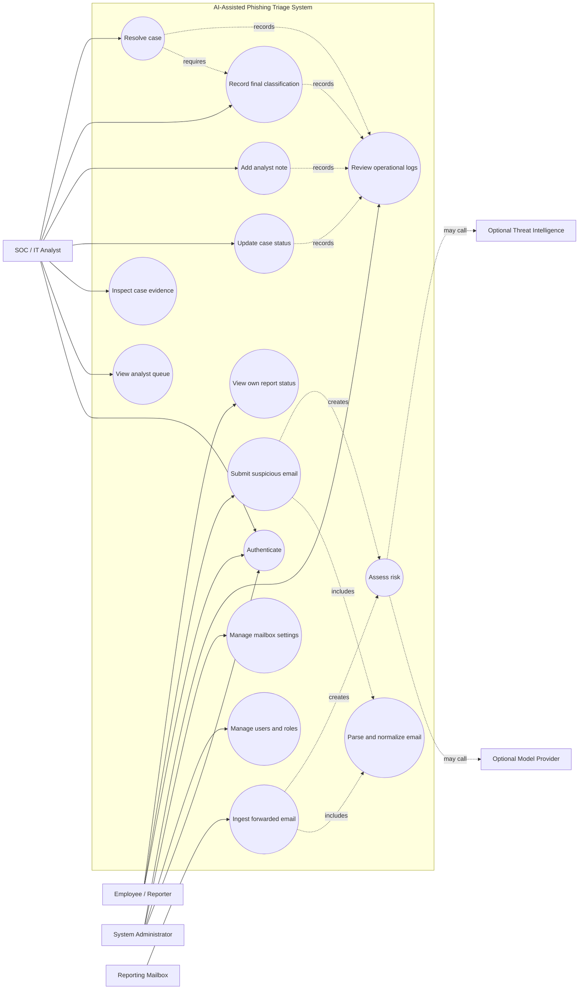
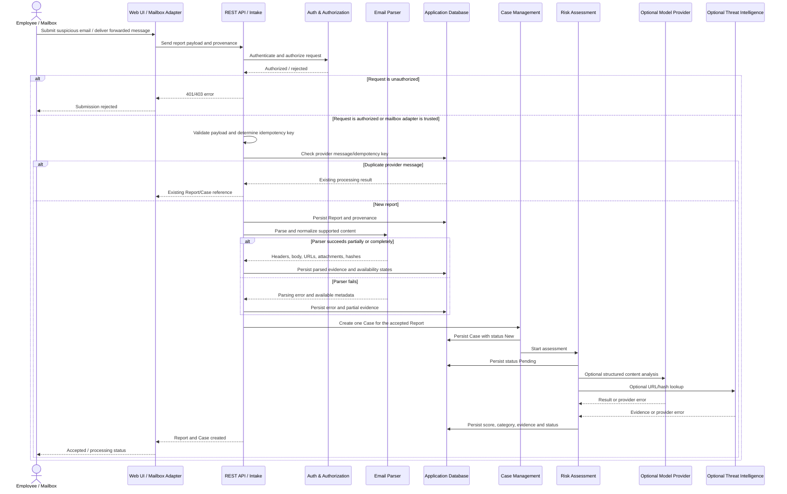
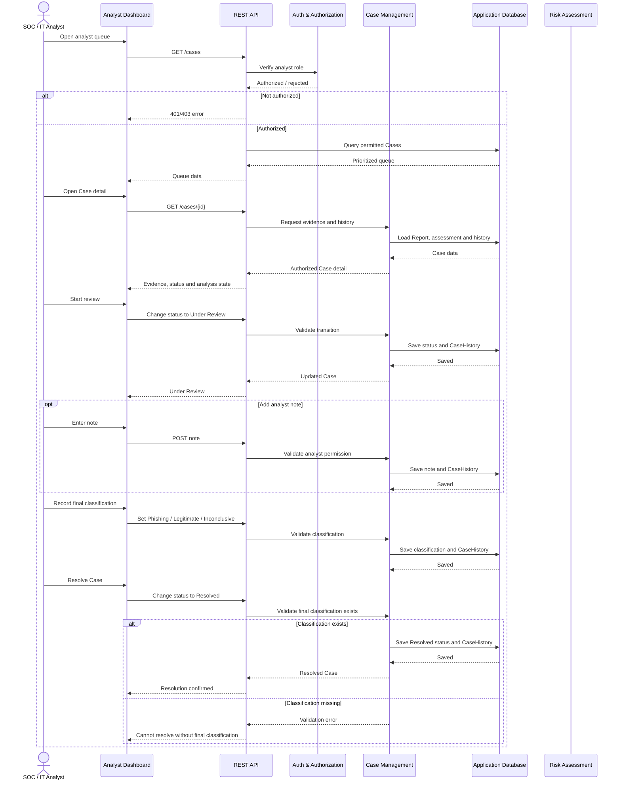
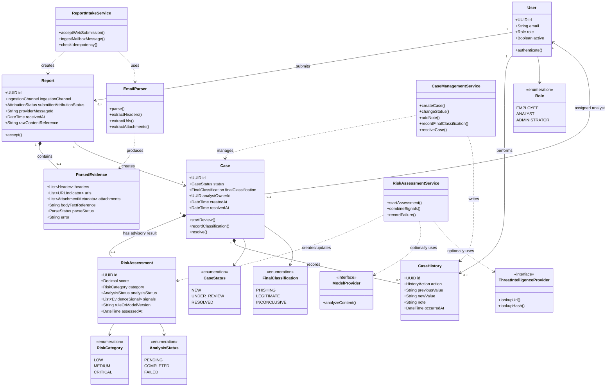
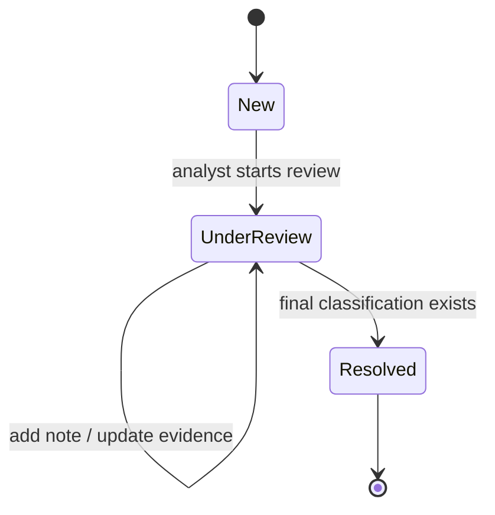
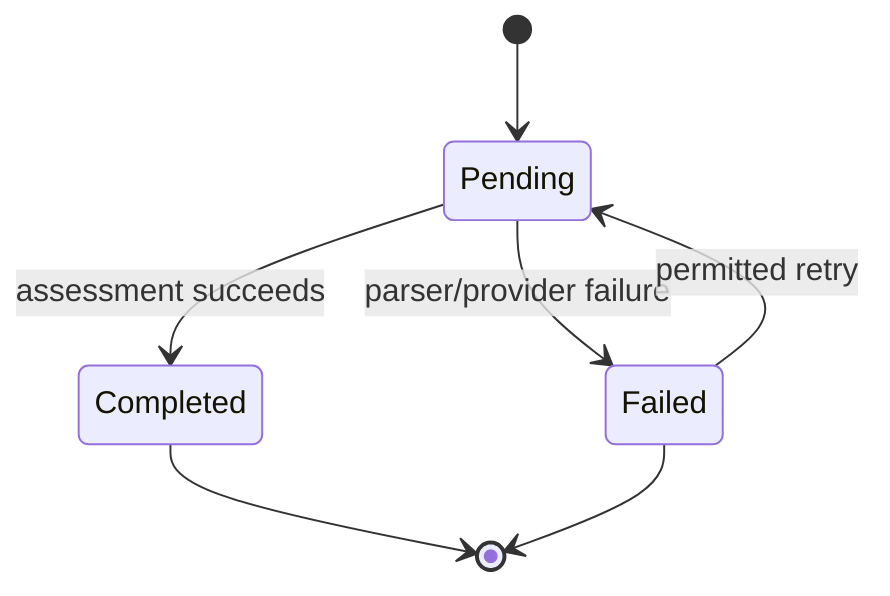

# UML Diagrams

## 1. Document Information

| Field | Value |
| --- | --- |
| Project | AI-Assisted Phishing Triage System |
| Course | SENG 321 – Software Engineering Project |
| Document | UML Diagrams |
| Version | 1.0 draft |
| Status | Sprint 2 working document |
| Related issue | GitHub Issue #24 |

This document describes the main structural and behavioral models of the AI-Assisted Phishing Triage System. The diagrams are written in Mermaid so their source remains editable, reviewable, and version-controlled in the repository.

The models are aligned with `docs/sprint2/SRS.md`, `docs/sprint2/architecture/C4.md`, `docs/PROJECT_PROPOSAL.md`, and `docs/SYSTEM_VISION_BOUNDARY.md`.

## 2. Modeling Conventions

- `Report` represents one submitted or mailbox-ingested suspicious email.
- `Case` represents the investigation record for exactly one accepted Report.
- `RiskAssessment` is advisory automation and is separate from the analyst's final decision.
- `Case.status` and `RiskAssessment.analysisStatus` have independent lifecycles.
- Email content, headers, URLs, and attachment metadata are untrusted data.
- Mermaid blocks are the editable diagram sources and can be rendered by a Mermaid-compatible Markdown viewer.

## 3. UML Use Case Diagram

The use case diagram identifies the primary actors and the principal system capabilities.

### 3.1 Use case notes

| Use case | Main actor | Important rule |
| --- | --- | --- |
| Authenticate | All human actors | Protected operations require valid authentication. |
| Submit suspicious email | Employee | Creates a Report and exactly one linked Case after validation. |
| View own report status | Employee | Only verified reports attributed to that employee are visible; analyst details are hidden. |
| Ingest forwarded email | Reporting Mailbox | Duplicate provider messages must not create duplicate processing results. |
| Parse and normalize email | System | Content is never executed; unavailable evidence remains explicitly unavailable. |
| Assess risk | System / optional providers | Produces an advisory `Low`, `Medium`, or `Critical` recommendation. |
| View analyst queue | Analyst | Shows authorized Cases and relevant status/risk information. |
| Inspect case evidence | Analyst | Separates observed evidence, unavailable checks, and automated interpretations. |
| Update case status | Analyst | Uses `New`, `Under Review`, and `Resolved`. |
| Add analyst note | Analyst | Creates an attributable CaseHistory record. |
| Record final classification | Analyst | Uses `Phishing`, `Legitimate`, or `Inconclusive`; remains separate from risk. |
| Resolve case | Analyst | Requires a final classification before changing status to `Resolved`. |
| Manage users/roles/settings/logs | Administrator | Administrator privileges do not automatically grant analyst privileges. |

## 4. Sequence Diagram – Phishing Report Processing

This sequence covers both the authenticated web submission and the common processing path after mailbox ingestion. The `channel` participant represents either the web form/API or the controlled mailbox adapter.

### 4.1 Processing invariants

1. A duplicate mailbox message does not create a second Report or Case.
2. A parser or external-provider failure does not delete an accepted Report.
3. A Case is created with status `New`; risk completion does not resolve the Case.
4. Automated risk is stored as an advisory assessment and cannot set final classification.
5. Missing authentication evidence is represented as unavailable, not as a successful check.

## 5. Sequence Diagram – Case Review and Status Update

This sequence shows the human-in-the-loop review workflow and the requirement that a final classification exists before resolution.

## 6. UML Class Diagram

The class diagram models the core domain entities, their relationships, and the main service abstractions. Exact database field types may be refined during implementation.

## 7. Class Responsibilities and Invariants

| Class | Responsibility | Key invariant |
| --- | --- | --- |
| `User` | Stores identity, role, and active status. | Role checks are enforced by the backend. |
| `Report` | Stores one submission and its provenance. | One accepted Report maps to exactly one Case. |
| `ParsedEvidence` | Stores safely extracted indicators and parse state. | Missing evidence is not treated as a positive or negative verdict. |
| `RiskAssessment` | Stores the automated advisory result. | Risk category is not the analyst's final classification. |
| `Case` | Stores investigation state and final decision. | `Resolved` requires a final classification. |
| `CaseHistory` | Stores attributable case actions and notes. | Significant actions include actor and timestamp. |
| `ReportIntakeService` | Coordinates web and mailbox intake and idempotency. | Duplicate provider messages are not processed twice. |
| `EmailParser` | Extracts safe message evidence. | Attachments and active content are never executed. |
| `RiskAssessmentService` | Orchestrates technical and optional external signals. | Provider failure leaves a human-review path. |
| `CaseManagementService` | Applies workflow rules and records history. | Invalid status transitions are rejected. |

## 8. State Models

### 8.1 Case state

### 8.2 Risk assessment state

Case status and risk-assessment status are independent. A `Failed` assessment does not resolve, delete, or hide a Case.

## 9. Consistency with C4 and Requirements

| UML model | Related architecture or requirement |
| --- | --- |
| Use Case diagram | SRS actors, FR-001–FR-020, and C4 system context |
| Report processing sequence | SRS FR-003–FR-012 and C4 intake/parser/risk containers |
| Case review sequence | SRS FR-013–FR-017 and analyst human-in-the-loop rule |
| Class diagram | C4 core data model and Report–Case 1:1 relationship |
| Case state model | SRS case status transition and resolution requirements |
| Risk state model | SRS analysis lifecycle and failure-handling requirements |

The diagrams deliberately do not show automatic analyst classification, automatic Case resolution, or autonomous mailbox remediation because those behaviors are outside the approved system boundary.

## 10. Open Decisions

- Confirm the final API endpoint names against the OpenAPI draft.
- Confirm whether `RiskAssessment` is stored as one current record or as a versioned assessment history.
- Confirm the concrete authentication/session classes after the implementation technology is selected.
- Export rendered diagram images if the course submission requires standalone image files in addition to the editable Mermaid source.
