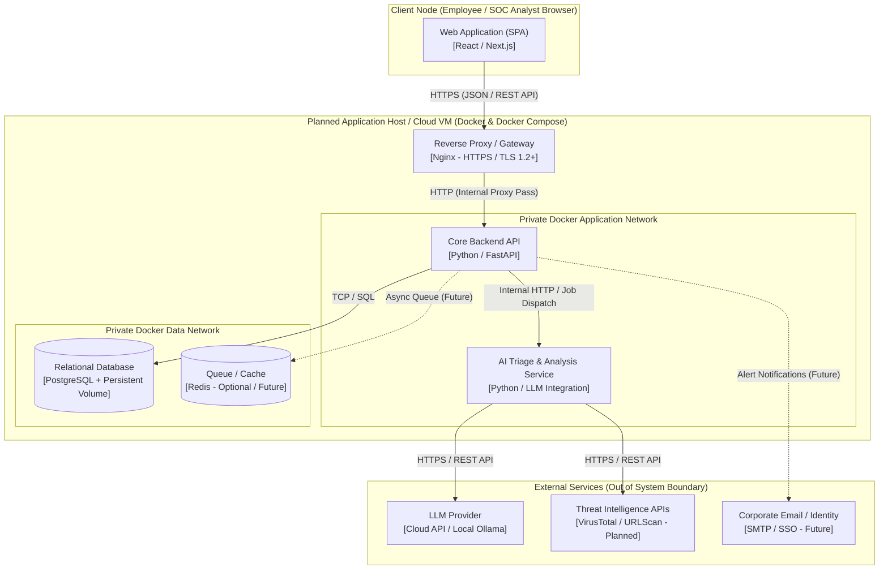

# Infrastructure and Deployment Plan

**Project:** AI-Assisted Phishing Triage System  
**Sprint:** Sprint 2  
**Author:** Muhammed Ali Bakır (DevOps Engineer)  
**Status:** Proposed (Design Phase)

---

## 1. Overview & Current vs. Planned Status

This document defines the proposed infrastructure, deployment topology, configuration management, and operational security approach for the **AI-Assisted Phishing Triage System**. It ensures that operational, security, and reliability considerations align with the system's C4 architecture and Non-Functional Requirements (NFRs).

> **Important Distinction (Implemented vs. Planned Infrastructure):**
> * **Currently Implemented (Sprint 1–2):** GitHub repository (`seng321-ai-powered-phishing-triage`), Git-Flow branching model (`main`, `develop`, `issue*-*` feature branches), branch protection rules (minimum 1 approving review required), Issue/PR traceability workflow, and project design/API documentation. **No cloud server, container cluster, or production database has been provisioned yet.**
> * **Planned Infrastructure (Sprint 3+):** All application containers, reverse proxies, databases, CI/CD workflows, secret stores, and monitoring tools detailed in this document represent the **proposed target infrastructure** to be provisioned and implemented during upcoming development sprints.

---

## 2. Alignment with C4 Architecture & NFR Specifications

To maintain architectural consistency across Sprint 2 deliverables, this deployment plan aligns with the Software Architect's C4 diagrams and QA's NFR specifications:

* **C4 Container Alignment:** Every container defined in the C4 Container view (Web Application, Core Backend API, AI Triage Service, and Relational Database) maps directly to an isolated deployment unit in the proposed topology below.
* **API Contract Alignment:** The Core Backend API deployment exposes the REST endpoints defined in `api/openapi.yaml` (e.g., `/reports`, `/reports/{id}`) strictly behind a TLS-terminating Reverse Proxy.
* **NFR Alignment:** Infrastructure choices address core NFR targets—specifically **Security** (TLS encryption, private internal networks, non-root containers, secret isolation), **Reliability** (persistent volumes, automated database backups, graceful degradation on external API failure), and **Maintainability** (containerized parity across dev/staging/prod).
* **Architect Review Checkpoint:** Final technology versions (e.g., PostgreSQL version, exact LLM provider integration, and container resource limits) will be co-verified with the Software Architect prior to Sprint 3 implementation.

---

## 3. Proposed Deployment Diagram (C4 Deployment View)

The diagram below illustrates the planned deployment nodes, containerized application services, data stores, and external service boundaries.

---

## 4. Application Services & Infrastructure Components

| Component | Planned Technology | Primary Responsibility | Network Exposure |
| :--- | :--- | :--- | :--- |
| **Reverse Proxy** | Nginx | Terminates HTTPS/TLS, routes requests to UI and Backend API, applies basic rate limiting and security headers. | Public (Ports 80/443) |
| **Frontend Web UI** | React / Next.js | Provides screens for employee phishing reporting, case list, case details, and SOC analyst triage verdicts. | Public (Served via Nginx / Static Host) |
| **Core Backend API** | Python (FastAPI) | Implements OpenAPI endpoints, authentication/authorization checks, request validation, and case workflow orchestration. | Internal Only (Behind Proxy) |
| **AI Triage Service** | Python Service / Worker | Parses suspicious email metadata/URLs, runs heuristic checks, and communicates with the LLM provider for risk scoring and summaries. | Internal Only |
| **Relational Database** | PostgreSQL | Persists phishing reports, risk scores, analyst decisions, user roles, and audit trail records. | Private Network Only (No public port) |
| **Container Runtime** | Docker & Docker Compose | Packages services with deterministic dependencies to guarantee environment parity from local machines to cloud hosts. | Host Infrastructure |

---

## 5. Planned Development & Deployment Environments

| Environment | Purpose | Planned Hosting Approach | Deployment Trigger |
| :--- | :--- | :--- | :--- |
| **Local Development** | Feature coding, local API testing, and unit test execution. | Developer workstation using `docker-compose.dev.yml` (volume mounts & hot-reload enabled). | Manual (`docker compose up`) |
| **Staging / QA** | Integration testing, QA verification against acceptance criteria, and Sprint demos. | Single-node Cloud VM (e.g., AWS EC2 / DigitalOcean) or university lab server running Docker Compose. | Merge into `develop` branch |
| **Production (Target)** | Live operation for employees and IT/SOC analysts (post-MVP target). | Hardened Cloud VM or managed container platform (e.g., AWS ECS / Render / Railway) with managed PostgreSQL. | Tagged release on `main` branch (e.g., `v1.0.0`) |

---

## 6. Configuration & Environment Variable Management

* **Twelve-Factor Config Separation:** All environment-specific parameters (ports, database connection strings, CORS origins, feature flags, log levels) are externalized via environment variables rather than hardcoded in source files.
* **Template Version Control:** A sanitized `.env.example` file listing all required keys with placeholder values will be maintained in the repository.
* **Git Exclusion Policy:** Real `.env`, `.env.local`, and `.env.production` files are strictly excluded via `.gitignore`.

### Planned Environment Variables (`.env.example` Reference)

| Variable Name | Scope | Description |
| :--- | :--- | :--- |
| `APP_ENV` | Core / AI | Runtime environment (`development`, `staging`, `production`). |
| `API_PORT` | Backend | Internal port bound by the FastAPI service (default `8000`). |
| `CORS_ALLOWED_ORIGINS` | Backend | Comma-separated list of trusted frontend origins. |
| `DATABASE_URL` | Backend | PostgreSQL connection string (injected securely per environment). |
| `LLM_PROVIDER_URL` | AI Service | Endpoint URL for the configured LLM provider. |
| `LLM_API_KEY` | AI Service | Secret authentication token for external LLM API calls. |
| `LOG_LEVEL` | Core / AI | Logging verbosity (`DEBUG`, `INFO`, `WARNING`, `ERROR`). |

---

## 7. Secrets & Sensitive Configuration Handling

Sensitive configuration includes database credentials, JWT signing secrets, and third-party API keys (LLM and Threat Intelligence providers).

* **Local Development:** Developers manage personal or sandbox keys in local `.env` files that are never committed to Git.
* **CI/CD & Remote Environments:** Production and staging secrets will be stored exclusively in **GitHub Actions Secrets** and the target cloud provider's encrypted secret/environment manager.
* **Code Hygiene:** Hardcoding credentials in source code, `Dockerfile`s, or `docker-compose.yml` is strictly prohibited. Pre-merge Pull Request reviews (and planned secret scanning in GitHub) enforce this rule.
* **Least Privilege & Rotation:** External API keys will be scoped to minimum required permissions and rotated immediately upon suspected compromise or team membership changes.

---

## 8. Logging, Monitoring, and Error-Handling Considerations

* **Structured Logging:** Backend and AI containers will write structured JSON logs (containing `timestamp`, `level`, `service`, `request_id`, and `message`) to `stdout`/`stderr` so Docker logging drivers can collect them uniformly.
* **PII & Sensitive Data Masking:** Passwords, JWT tokens, API keys, and unnecessary raw personal email contents will be redacted before logging to protect employee privacy.
* **Health Checks:** The Core Backend API will expose a lightweight `/health` endpoint for Docker container `HEALTHCHECK` directives and reverse proxy readiness verification.
* **Standardized Error Handling:** Unhandled exceptions are caught by global middleware and returned using the standardized error schema defined in `api/openapi.yaml` (`4xx`/`5xx` HTTP codes). Internal stack traces are logged internally but never exposed to end users in staging/production.
* **Monitoring (Planned):** Basic container uptime, CPU/RAM usage, and API error-rate monitoring will be configured via host metrics or lightweight open-source dashboards in later sprints.

---

## 9. Infrastructure Security & Reliability Requirements

* **Encryption in Transit:** All external client-to-proxy and service-to-external-API communications must use HTTPS (TLS 1.2 or higher).
* **Network Segmentation:** Database and AI worker containers run on internal Docker bridge networks and have **no ports exposed to the public internet**.
* **Container Hardening:** Services will use minimal official base images (e.g., `python:3.11-slim`, `node:20-alpine`) and execute as non-root users inside containers.
* **Data Persistence & Backup:** PostgreSQL data resides on a named Docker volume. Scheduled daily logical backups (`pg_dump`) with retention policies are planned for staging and production.
* **Graceful Degradation (Fault Tolerance):** If an external LLM or Threat Intelligence API experiences downtime or rate-limiting, the Backend API must still persist the submitted phishing report with a `PENDING_ANALYSIS` status and queue/flag it for retry or manual SOC review rather than dropping the user submission.

---

## 10. Assumptions, Limitations, and Future Implementation Requirements

### Assumptions
* Initial deployment targets an academic pilot scale (low-to-moderate concurrent users) suitable for a single containerized host.
* All developers have Docker Desktop or Docker Engine (Linux/WSL2) available locally for Sprint 3+ development.
* External LLM access (API key or local model server) will be provisioned before AI worker integration testing.

### Limitations
* A single-node Docker Compose topology does not provide automatic multi-region failover or zero-downtime horizontal autoscaling out of the box.
* Real-time triage latency depends on external LLM API response times and rate limits.
* Enterprise integrations (Active Directory SSO, automated corporate mailbox quarantine) are out of scope for the initial MVP deployment.

### Future Implementation Requirements (Sprint 3+)
1. Author `Dockerfile` definitions for Frontend, Backend API, and AI Triage Service.
2. Create `docker-compose.yml` (staging/prod baseline), `docker-compose.dev.yml` (local dev), and `.env.example`.
3. Configure GitHub Actions CI pipeline for automated linting, OpenAPI YAML validation, and unit/integration test execution on every Pull Request to `develop`.
4. Provision a staging VM/host with Nginx + Let's Encrypt TLS certificates for Sprint 3/4 demos.
