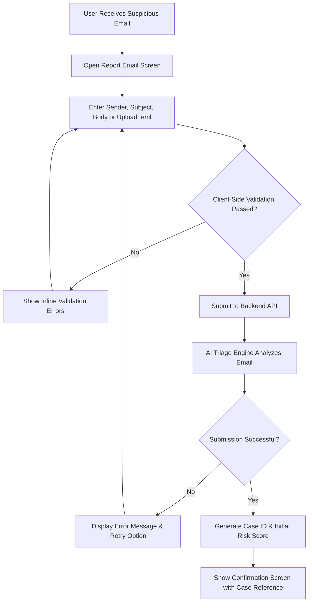
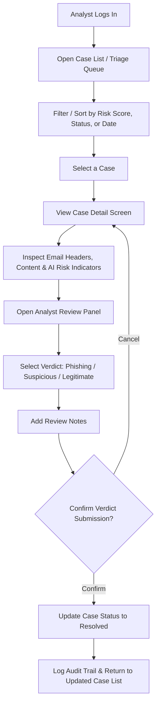
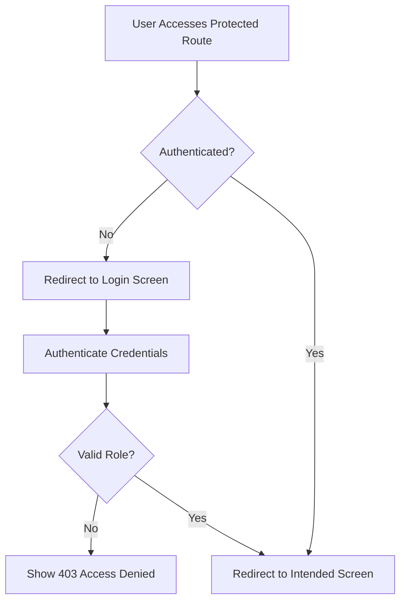

# User Flow Diagrams — AI-Powered Phishing Triage System

## 1. Overview
This document defines the primary end-to-end user journeys for the **AI-Powered Phishing Triage System**. The flows cover two core roles:
- **End User (Reporter):** Submits suspicious emails for automated triage.
- **Security Analyst:** Reviews triaged cases, inspects AI-generated risk explanations, and records final verdicts.

---

## 2. Flow 1: Suspicious Email Reporting (End User)

### Key Steps
1. The user navigates to the **Report Email** screen and inputs email metadata/content or uploads a raw `.eml` file.
2. Required fields (sender address, subject, content) are validated before submission.
3. Upon submission, the system creates a triage case, runs automated AI risk scoring, and returns a confirmation with a tracking ID.

---

## 3. Flow 2: Case Triage & Analyst Review (Security Analyst)

### Key Steps
1. The analyst accesses the **Case List**, prioritized by AI risk level (`High`, `Medium`, `Low`).
2. Selecting a case opens **Case Details**, displaying original email artifacts alongside AI-extracted phishing indicators (suspicious URLs, domain mismatches, urgency cues).
3. The analyst assigns a final verdict, attaches justification notes, and submits the review to close the case.

---

## 4. Flow 3: Authentication & Role-Based Access Handling

